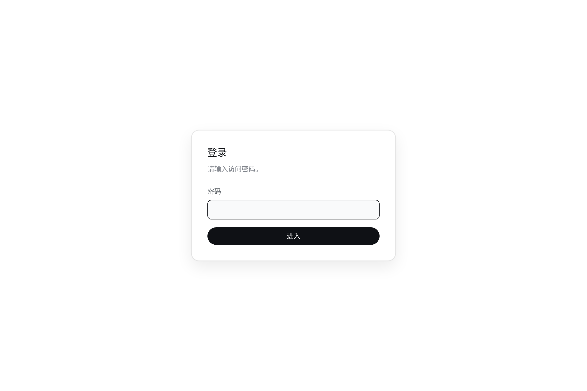

# dsh-gateway

A secure, installable gateway for the
[DeepSeek Harness](https://github.com/deepseek-ai/deepseek-harness) web UI.

The dsh web server itself is left untouched. This bundle adds **one** row to
the `web` profile: a gateway that starts beside `dsh web`, asks for a password
on first use, proxies authenticated HTTP and WebSocket traffic to dsh, bridges
dsh's own browser-session gate, and can deliver the page as an installable PWA.



## Why “gateway”

Authentication is still the front door, but the bundle owns the whole
browser-facing access layer: password sessions, reverse proxying, loopback
identity for upstream plugins, dsh session recovery, PWA assets, service-worker
caching, and Host-mode injection. A gateway describes that boundary.

The package, bundle row, environment prefix, session cookie and data directory
all use `dsh-gateway` / `gateway`.

## How it works

- First visit: no password is stored yet, so `/login` shows the **set
  password** form.
- The password is hashed with **bcrypt** and written to
  `~/.dsh/profiles/gateway/auth.json`.
- After setup (or on later visits), entering the password exchanges it for a
  random 256-bit session token. The token is stored server-side in
  `~/.dsh/profiles/gateway/session.json` and delivered as a plain session
  cookie (`dsh_gateway_session`, no extra attributes by default).
- Every authenticated request refreshes that token's expiry by 24 hours
  (rolling expiry).
- Once authenticated, requests are proxied straight back to the dsh web server
  listening on its original port.
- The proxy also satisfies dsh's **own** browser-session gate, so the password
  page is the only login you see. dsh protects every `/api` call and WebSocket
  stream with a signed cookie whose name and payload are bound to the request
  authority (host + port), and it only hands that cookie out by redeeming a
  per-process launch token on `GET /`. The gateway forwards every upstream
  request as the loopback authority, so it redeems the token for that same
  authority and forwards the cookie dsh expects (dropping any `dsh-auth-*`
  cookie the browser holds). An expired cookie is refreshed and the request
  retried once, so a dsh restart does not bounce you back to 401.
- Authenticated HTTP requests **and WebSocket upgrades** are presented upstream
  as loopback: `Host` and `Origin` are rewritten to
  `http://127.0.0.1:<dsh web port>`, and `Referer` is translated to match.
  dsh itself and plugins that require a local host therefore treat traffic
  through this gateway as local without any Traefik/nginx header middleware.
  `Sec-Fetch-Site` is left untouched so cross-site requests are still rejected.
- By default the gateway also serves PWA assets (`/manifest.webmanifest`,
  `/sw.js`, `/favicon.svg`) and injects the manifest link plus a caching
  service-worker registration into HTML pages. The service worker keeps a
  network-first app shell and a cache-first store for content-addressed
  `/assets/*` and `/plugins/*?rev=…` bundles, so repeat and weak-network
  loads do not refetch unchanged JavaScript and CSS. API traffic, login
  pages and WebSocket upgrades are never cached. The manifest references the
  SVG icon only. This makes the gateway origin installable as a standalone web
  app on `localhost`/HTTPS.

A `~/.dsh/profiles/gateway/.gitignore` is created on first run to keep
`auth.json`, `session.json` and `settings.json` out of git.

## Gateway configuration page

The bundle keeps **one row** for the whole gateway. PWA and Host mode are not
qol-style independently loadable components: they share the proxy lifecycle,
and authentication/forwarding must never become an independently switchable
item. Instead, the features and their status live on the row's own page under
**Plugins → @gitsang/dsh-gateway → Gateway → Configure**. Nothing is injected
into Settings.

The page contains:

- **运行状态** — listen address, upstream dsh, active sessions, uptime,
  version and data directory.
- **浏览器体验** — PWA switch and a button that clears the gateway's offline
  caches.
- **访问控制** — change the password (other sessions are revoked) and sign
  out of every device.
- **兼容性** — Host mode switch, with the security warning and restart
  requirement stated inline.

Saving the form stages both switches and writes on **Save**. PWA changes take
effect on the next page request. Host mode requires a restart of `dsh web`,
because dsh's index injection is composed during boot. Settings saved on this
page live in `settings.json`; they deliberately do not use dsh's
own settings store, because turning Host mode off removes the browser's
Host-settings transport and the gateway page must still be able to turn it back
on.

Environment variables win over the configuration page. When a toggle is managed by
an environment variable, the page shows it as read-only.

The settings API is authenticated by the same gateway session cookie. Mutating
requests additionally require a same-origin `x-dsh-gateway: 1` header.

## Install

Add the bundle to the existing `web` profile:

```bash
dsh plugin --profile web add github:gitsang/dsh-gateway
```

Then start dsh web as usual:

```bash
dsh web
```

The dsh web server still listens on `127.0.0.1:3080`; the gateway listens
on the dsh web port plus one (`127.0.0.1:3081` for the default dsh web port).
Open:

```bash
http://127.0.0.1:3081
```

## Configuration

All configuration is optional and read from environment variables at boot.

| Variable                | Default                   | Meaning                                               |
| ----------------------- | ------------------------- | ----------------------------------------------------- |
| `DSH_GATEWAY_HOST`      | `127.0.0.1`               | Gateway bind host                                     |
| `DSH_GATEWAY_PORT`      | `dsh web port + 1`        | Gateway listen port (overrides the default)           |
| `DSH_GATEWAY_TTL_MS`    | `86400000`                | Rolling session expiry (24h)                          |
| `DSH_GATEWAY_DATA_DIR`  | `~/.dsh/profiles/gateway` | Directory for auth, session and gateway settings      |
| `DSH_GATEWAY_PWA`       | `1`                       | Serve PWA assets and inject PWA tags into HTML        |
| `DSH_GATEWAY_HOST_MODE` | `1`                       | Declare the page a host-owning page (Host settings)   |
| `DSH_HOME`              | `~/.dsh`                  | dsh home (used when `DSH_GATEWAY_DATA_DIR` is unset)  |

### PWA (installable web app)

PWA injection is enabled by default. The gateway serves the manifest, service
worker and `/favicon.svg` itself, and injects the required tags into the login
page and proxied HTML responses. Toggle it on the gateway's **Configure** page, or set
`DSH_GATEWAY_PWA=0` to lock it off from the environment.

The service worker uses two caches:

- `dsh-gateway-shell-v1` holds the last authenticated HTML document plus the
  manifest and icon. A navigation is network-first; when the network is slower
  than three seconds or unavailable, the cached shell is shown. A successful
  navigation replaces it, so a changed deployment is picked up on the next
  load.
- `dsh-gateway-assets-v1` is cache-first for immutable resources:
  Vite's hashed `/assets/*` files and dsh's `/plugins/*?rev=…` bundles. A
  new build produces a new URL, so unchanged resources stay cached while
  changed resources are fetched once. The cache is trimmed to the newest 300
  entries.

`/api/*`, `/login`, `/logout`, `/connect`, `/sw.js`, range requests and
non-GET requests bypass the service worker. Responses that redirect (for
example to the login page), fail, or carry `Cache-Control: no-store` are not
stored. Opening the login page also clears the cached app shell, so logging
out does not leave the authenticated document available offline.

When PWA is disabled, `/sw.js` serves a cleanup worker that deletes the
gateway caches and unregisters itself, so an already-installed worker does not
keep serving an old offline shell.

The gateway also adds HTTP cache headers for clients that do not run a service
worker: hashed assets are
`Cache-Control: public, max-age=31536000, immutable`, HTML is
`private, no-cache` (plus `Vary: Cookie`), and `/api/*` is `no-store`.

Browser install prompts require a secure context. `http://127.0.0.1:3081` and
`http://localhost:3081` qualify; an exposed `http://192.168.x.x:3081` LAN URL
does **not**. For LAN installability, terminate HTTPS in front of the gateway
with a certificate the browser trusts.

### Host mode (settings, Models page)

dsh only lets a page read and write Host settings when it believes it is the
owning host. Its client decides that with
`ctx.remote.$host.isLoopback`, which is true for a loopback hostname, or when
the page declares `globalThis.__DSH_TRANSPORT__ = { ownsHost: true }` — the
same flag the Desktop shell sets.

A page served through this gateway is never on a loopback hostname, so without
that flag dsh falls back to its process-local `memory` settings transport. The
visible symptom is **Settings → Models: "Loading the provider directory
failed: settings are unavailable in this browser"**, and no settings change
survives a reload.

Host mode carries the flag two ways:

1. **Primary — native index injection.** The plugin pushes a
   `webserver/index-inject` row, so dsh itself renders

   ```html
   <script>globalThis["__DSH_TRANSPORT__"] = {"ownsHost":true}</script>
   ```

   into its own `index.html`. This survives gzip, caching reverse proxies and
   any hop that rewrites or re-serves our responses.

2. **Fallback — head rewrite.** The gateway also patches the tag into HTML it
   relays, which keeps working if some deployment serves the page from
   somewhere else.

It is **on by default**, because a remote dsh web UI is otherwise unable to
edit providers. Toggle it on the gateway's **Configure** page, or set
`DSH_GATEWAY_HOST_MODE=0`. A change requires restarting `dsh web`.

Injection needs the upstream HTML uncompressed, so for HTML navigation
requests only (`Accept: text/html`) the gateway drops `Accept-Encoding`; scripts,
styles and API payloads keep their compression. The same rewrite path is what
makes the PWA tags work in a real browser.

### Loopback identity for upstream plugins

Once a request has passed the password gate, the gateway presents it to dsh as
a local request. This is deliberate: dsh's `/api` trust fence and many plugins
special-case loopback hosts, and a remote HTTPS reverse proxy would otherwise
make them reject an already-authenticated user.

The translation applies to ordinary HTTP and WebSocket upgrades:

| Browser sends                          | Upstream receives                         |
| -------------------------------------- | ----------------------------------------- |
| `Host: dsh.example.com`                | `Host: 127.0.0.1:3080`                    |
| `Origin: https://dsh.example.com`      | `Origin: http://127.0.0.1:3080`           |
| `Referer: https://dsh.example.com/...` | `Referer: http://127.0.0.1:3080/...`      |

The loopback cookie that satisfied dsh's own browser-session gate is minted for
the same rewritten authority, so `/api` RPC and WebSocket streams continue to
work without exposing that cookie to the browser.

Because of this, reverse-proxy header middleware is no longer needed. For
example, a Traefik router can point straight at the gateway and omit the old
`Host`/`Origin` injection:

```yaml
http:
  routers:
    to-dsh:
      rule: Host(`dsh.example.com`)
      tls:
        certResolver: aliResolver
      service: dsh

  services:
    dsh:
      loadBalancer:
        servers:
          - url: "http://127.0.0.1:3081"
```

Do **not** apply this translation to a route that bypasses dsh-gateway (for
example a raw `:3080` route): that would hand unauthenticated traffic the same
local identity. Keep dsh web bound to loopback and route external traffic only
through the gateway.

### Exposing through the gateway

The dsh web server itself is loopback-only (`--host 0.0.0.0` is rejected by
dsh web). To expose the UI on the LAN through this gateway, run:

```bash
DSH_GATEWAY_HOST=0.0.0.0 dsh web
```

No `--trusted-host` flag is needed for proxied requests anymore: after the
password gate, the gateway rewrites `Host`/`Origin` to the loopback upstream.
Keep `--trusted-host` only if something else still reaches dsh directly under
a non-loopback authority.

## Forgot password

Delete the stored hash file:

```bash
rm ~/.dsh/profiles/gateway/auth.json
```

The next visit will show the setup form again. You may also want to clear the
session file:

```bash
rm ~/.dsh/profiles/gateway/session.json
```

## Security notes

This is intentionally minimal: no rate limiting, no `HttpOnly`/`Secure`/
`SameSite` cookie attributes, and sessions are stored as plain text
token→expiry entries. Use it as a lightweight gate for a trusted local
network, not as an internet-facing authentication layer.

**Loopback identity widens that gate.** Every authenticated request reaches
dsh as if it came from the local machine. Only the password gate separates an
authenticated remote browser from host-local plugin surfaces, so keep the
gateway itself behind HTTPS and do not expose dsh's raw port.

**Host mode widens that gate.** `ownsHost: true` gives every signed-in browser
the same configuration surface the Desktop shell has: editing settings (which
writes `cordis.patch.yml`), the "open configuration file" action, and
installing or enabling plugin bundles. Since a plugin bundle is code the Host
loads, anyone who can sign in can effectively run code on this machine. Keep
Host mode on only where every account with the password is trusted to do that,
and turn it off on the gateway's **Configure** page (or with
`DSH_GATEWAY_HOST_MODE=0`) otherwise.
