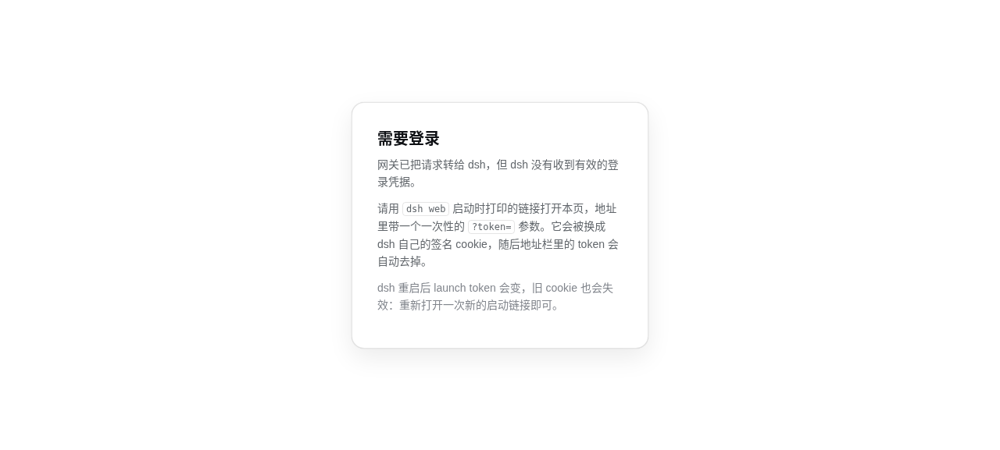
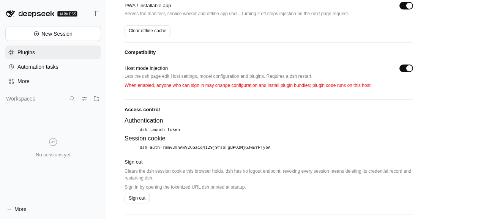

# dsh-gateway

An installable gateway for the
[DeepSeek Harness](https://github.com/deepseek-ai/deepseek-harness) web UI.

The dsh web server itself is left untouched. This bundle adds **one** row to
the `web` profile: a gateway that starts beside `dsh web`, reverse proxies HTTP
and WebSocket traffic to it, relays dsh's own token authentication, and can
deliver the page as an installable PWA.

Authentication is **dsh's**, not the gateway's. The gateway owns no password
and no session store: it forwards the signed cookie dsh minted and lets dsh
decide. Its one credential-related job is keeping the sign-in token stable
across restarts (see [Long-lived sign-in token](#long-lived-sign-in-token)).

## Why "gateway"

The bundle owns the browser-facing access layer — reverse proxying, loopback
identity for upstream plugins, credential relay, PWA assets, service-worker
caching, and Host-mode injection — while dsh keeps owning identity. A gateway
describes that boundary.

The package, bundle row, environment prefix and data directory all use
`dsh-gateway` / `gateway`.

## How authentication works

dsh mints one random launch token per process and prints (and usually opens) its
application URL with `?token=…` (the gateway replaces that per-process token
with a persistent one; see below). `GET /?token=…` exchanges the token for a
signed browser cookie and redirects to the clean `./`. The cookie is:

- named `dsh-auth-<base64url sha256 of the request authority>`,
- bound to the authority (hostname + port, plus scheme on TLS) it was minted for,
- `HttpOnly; SameSite=Strict; Path=/`, valid 30 days by default,
- `Secure` only when the listener that received the request serves TLS.

The gateway relays that exchange instead of replacing it:

1. A browser opens the **gateway** URL printed at startup
   (`http://127.0.0.1:3081/?token=…`).
2. The gateway forwards the request to dsh with `Host` rewritten to the
   loopback upstream, so dsh mints the cookie for `127.0.0.1:<dsh port>` — the
   same authority every later proxied request presents.
3. dsh answers `303` with `Set-Cookie: dsh-auth-…`; the gateway relays it,
   adding `Secure` when the browser-facing hop is HTTPS (see below).
4. Every subsequent HTTP request and WebSocket upgrade carries that cookie.
   The gateway forwards it **unchanged** to dsh, which accepts or rejects it.

There is no gateway login page and no gateway session. If a browser shows up
without a valid cookie, dsh answers `401`, and the gateway turns that into a
short explanation page for top-level navigations instead of relaying dsh's
bare one-line text. API traffic keeps dsh's own `401`/`403`.



### Signing in

Opening the plain gateway origin does nothing useful until a browser holds a
cookie. Sign in with the URL the gateway prints:

```
dsh-gateway: http://127.0.0.1:3081 -> http://127.0.0.1:3080
dsh-gateway: sign in with http://127.0.0.1:3081/?token=… (stable across restarts)
```

### Long-lived sign-in token

dsh itself mints a fresh random launch token per process, which would force
every new browser to fetch the new startup URL after each restart. The gateway
installs a **persistent token** instead, so the sign-in URL above never changes
and can be bookmarked or stored in a password manager:

- By default the gateway generates one random 256-bit token on first run and
  persists it to `~/.dsh/profiles/gateway/token.txt` (owner-only permissions,
  git-ignored).
- `DSH_GATEWAY_TOKEN` overrides it with a token you choose (at least 22
  base64url characters, `[A-Za-z0-9_-]`). The env value is never written to
  disk; removing the env falls back to the persisted/generated token.
- **Rotate** by deleting `token.txt` (or changing the env value) and restarting
  `dsh web`. The old URL stops working; browsers that already hold a cookie
  keep working, because cookies are signed with dsh's separate persistent
  secret, not the launch token.
- Revoking every *cookie* is still dsh's operation: delete the
  `client-connection/browser-session` record from `$DSH_HOME/.credentials.yaml`
  and restart.

Implementation note: dsh exposes no configuration for a stable token, so the
gateway assigns its token to the Connection service's
`browserAuth.launchToken` at boot and verifies through the public
`authenticatedUrl()` that the assignment took effect. This is a deliberate
dependency on a dsh internal. If a future dsh version moves that field, the
gateway logs a warning and falls back to the stock behavior (a fresh token per
restart, printed in the startup line) — sign-in keeps working either way. The
configuration page shows which mode is active (**登录 Token**: 长期有效 /
每次重启更换).

### Signing out

dsh documents no logout operation — "clearing the browser cookie ends one
browser session". Because dsh's cookie is `HttpOnly`, page JavaScript cannot
clear it, so the gateway's configuration page offers **退出登录**: it writes an
expired `Max-Age=0` copy of the exact cookie name for the forwarded authority,
drops the offline caches, and reloads.

Revoking *every* session is dsh's own operation, not the gateway's:

```bash
# delete the owner-scoped browser-session grant from $DSH_HOME/.credentials.yaml
# (or replace it), then restart dsh
```

## How it works

- Once a request reaches the gateway, it is proxied to dsh's loopback port.
  `Host` and `Origin` are rewritten to `http://127.0.0.1:<dsh web port>`, and
  `Referer` is translated to match, so dsh and plugins that require a local
  host treat traffic through this gateway as local without any
  Traefik/nginx header middleware. `Sec-Fetch-Site` is left untouched so
  cross-site requests are still rejected by dsh's CSRF fence.
- The browser's `Cookie` header is forwarded as-is, minus the obsolete
  `dsh_gateway_session` cookie from the removed password gate. Every
  `dsh-auth-*` cookie the browser holds reaches dsh untouched, including the
  one minted for the loopback authority.
- Response cookies are relayed as dsh sent them. The only edit is adding
  `Secure` to the `dsh-auth-*` cookie when the browser-facing hop is HTTPS: dsh
  marks that cookie `Secure` only when *its own* listener terminates TLS, and a
  gateway behind a TLS proxy speaks plain HTTP upstream. Without this the
  browser would hold a non-`Secure` bearer cookie on an HTTPS origin.
- Absolute `Location` headers pointing at the loopback upstream are translated
  back to the public origin.
- By default the gateway also serves PWA assets (`/manifest.webmanifest`,
  `/sw.js`, `/favicon.svg`) and injects the manifest link plus a caching
  service-worker registration into HTML pages. The service worker keeps a
  network-first app shell and a cache-first store for content-addressed
  `/assets/*` and `/plugins/*?rev=…` bundles, so repeat and weak-network loads
  do not refetch unchanged JavaScript and CSS. API traffic, the gateway's own
  settings API, dsh's token exchange and WebSocket upgrades are never cached,
  and a navigation that comes back `401` drops the cached shell so signing out
  does not leave the authenticated document available offline. The manifest
  references the SVG icon only. This makes the gateway origin installable as a
  standalone web app on `localhost`/HTTPS.

On first run the gateway creates a `~/.dsh/profiles/gateway/.gitignore` keeping
`settings.json` and `token.txt` out of git.

## Gateway configuration page

The bundle keeps **one row** for the whole gateway. PWA and Host mode are not
qol-style independently loadable components: they share the proxy lifecycle,
and forwarding must never become an independently switchable item. Instead,
the features and their status live on the row's own page under
**Plugins → @gitsang/dsh-gateway → Gateway → Configure**. Nothing is injected
into Settings.

The page contains:

- **浏览器体验** — PWA switch and a button that clears the gateway's offline
  caches.
- **兼容性** — Host mode switch, with the security warning and restart
  requirement stated inline.
- **访问控制** — the authentication provider, whether the sign-in token is
  persistent, the exact cookie name, the sign-in hint, and a **退出登录**
  button that expires this browser's cookie.
- **运行状态** — listen address, upstream dsh, uptime, version and data
  directory.



Saving the form stages both switches and writes on **Save**. PWA changes take
effect on the next page request. Host mode requires a restart of `dsh web`,
because dsh's index injection is composed during boot. Settings saved on this
page live in `settings.json`; they deliberately do not use dsh's own settings
store, because turning Host mode off removes the browser's Host-settings
transport and the gateway page must still be able to turn it back on.

Environment variables win over the configuration page. When a toggle is managed
by an environment variable, the page shows it as read-only.

The settings API (`/__dsh_gateway/*`) is authenticated by the very cookie dsh
minted: the gateway validates the caller with one loopback `HEAD /` carrying the
browser's cookie, and dsh answers `200` only for an unexpired, correctly signed
cookie for the forwarded authority. Mutating requests additionally require a
same-origin `x-dsh-gateway: 1` header.

## Install

Add the bundle to the existing `web` profile:

```bash
dsh plugin --profile web add github:gitsang/dsh-gateway
```

Then start dsh web as usual:

```bash
dsh web
```

The dsh web server still listens on `127.0.0.1:3080`; the gateway listens
on the dsh web port plus one (`127.0.0.1:3081` for the default dsh web port).
Open the sign-in URL the gateway prints, not the bare origin.

### Upgrading from 0.2 (password gate)

Version 0.3 removes the password gate. There is nothing to migrate:

- `auth.json` and `session.json` in the data directory are no longer read. Delete
  them if you like; they contain a now-unused bcrypt hash and dead session
  tokens.
- Any browser holding the old `dsh_gateway_session` cookie is signed out by
  that change; the gateway also strips that cookie instead of forwarding it.
- `DSH_GATEWAY_TTL_MS` is gone (the session lifetime is dsh's
  `cookieMaxAgeDays`, 30 days).
- Open the sign-in URL printed at the next `dsh web` startup to sign in again.

## Configuration

All configuration is optional and read from environment variables at boot.

| Variable                | Default                   | Meaning                                               |
| ----------------------- | ------------------------- | ----------------------------------------------------- |
| `DSH_GATEWAY_HOST`      | `127.0.0.1`               | Gateway bind host                                     |
| `DSH_GATEWAY_PORT`      | `dsh web port + 1`        | Gateway listen port (overrides the default)           |
| `DSH_GATEWAY_DATA_DIR`  | `~/.dsh/profiles/gateway` | Directory for gateway settings                        |
| `DSH_GATEWAY_PWA`       | `1`                       | Serve PWA assets and inject PWA tags into HTML        |
| `DSH_GATEWAY_HOST_MODE` | `1`                       | Declare the page a host-owning page (Host settings)   |
| `DSH_GATEWAY_TOKEN`     | generated, persisted      | Fixed sign-in token (≥22 base64url chars); see above  |
| `DSH_HOME`              | `~/.dsh`                  | dsh home (used when `DSH_GATEWAY_DATA_DIR` is unset)  |

### PWA (installable web app)

PWA injection is enabled by default. The gateway serves the manifest, service
worker and `/favicon.svg` itself, and injects the required tags into the 401
page and proxied HTML responses. Toggle it on the gateway's **Configure** page, or set
`DSH_GATEWAY_PWA=0` to lock it off from the environment.

The service worker uses two caches:

- `dsh-gateway-shell-v1` holds the last authenticated HTML document plus the
  manifest and icon. A navigation is network-first; when the network is slower
  than three seconds or unavailable, the cached shell is shown. A successful
  navigation replaces it, so a changed deployment is picked up on the next
  load. A `401` navigation clears the cache.
- `dsh-gateway-assets-v1` is cache-first for immutable resources:
  Vite's hashed `/assets/*` files and dsh's `/plugins/*?rev=…` bundles. A
  new build produces a new URL, so unchanged resources stay cached while
  changed resources are fetched once. The cache is trimmed to the newest 300
  entries.

`/api/*`, `/__dsh_gateway/*`, `/sw.js`, range requests and non-GET requests
bypass the service worker. Responses that redirect (for example dsh's token
exchange), fail, or carry `Cache-Control: no-store` are not stored.

When PWA is disabled, `/sw.js` serves a cleanup worker that deletes the
gateway caches and unregisters itself, so an already-installed worker does not
keep serving an old offline shell.

The gateway also adds HTTP cache headers for clients that do not run a service
worker: hashed assets are
`Cache-Control: public, max-age=31536000, immutable`, HTML is
`private, no-cache` (plus `Vary: Cookie`), and `/api/*` is `no-store`.

Browser install prompts require a secure context. `http://127.0.0.1:3081` and
`http://localhost:3081` qualify; an exposed `http://192.168.x.x:3081` LAN URL
does **not**. For LAN installability, terminate HTTPS in front of the gateway
with a certificate the browser trusts.

### Host mode (settings, Models page)

dsh only lets a page read and write Host settings when it believes it is the
owning host. Its client decides that with
`ctx.remote.$host.isLoopback`, which is true for a loopback hostname, or when
the page declares `globalThis.__DSH_TRANSPORT__ = { ownsHost: true }` — the
same flag the Desktop shell sets.

A page served through this gateway is never on a loopback hostname, so without
that flag dsh falls back to its process-local `memory` settings transport. The
visible symptom is **Settings → Models: "Loading the provider directory
failed: settings are unavailable in this browser"**, and no settings change
survives a reload.

Host mode carries the flag two ways:

1. **Primary — native index injection.** The plugin pushes a
   `webserver/index-inject` row, so dsh itself renders

   ```html
   <script>globalThis["__DSH_TRANSPORT__"] = {"ownsHost":true}</script>
   ```

   into its own `index.html`. This survives gzip, caching reverse proxies and
   any hop that rewrites or re-serves our responses.

2. **Fallback — head rewrite.** The gateway also patches the tag into HTML it
   relays, which keeps working if some deployment serves the page from
   somewhere else.

It is **on by default**, because a remote dsh web UI is otherwise unable to
edit providers. Toggle it on the gateway's **Configure** page, or set
`DSH_GATEWAY_HOST_MODE=0`. A change requires restarting `dsh web`.

Injection needs the upstream HTML uncompressed, so for HTML navigation
requests only (`Accept: text/html`) the gateway drops `Accept-Encoding`; scripts,
styles and API payloads keep their compression. The same rewrite path is what
makes the PWA tags work in a real browser.

### Loopback identity for upstream plugins

The gateway presents every request to dsh as a local request. This is
deliberate: dsh's `/api` trust fence and many plugins special-case loopback
hosts, and a remote HTTPS reverse proxy would otherwise make them reject an
otherwise valid request.

The translation applies to ordinary HTTP and WebSocket upgrades:

| Browser sends                          | Upstream receives                         |
| -------------------------------------- | ----------------------------------------- |
| `Host: dsh.example.com`                | `Host: 127.0.0.1:3080`                    |
| `Origin: https://dsh.example.com`      | `Origin: http://127.0.0.1:3080`           |
| `Referer: https://dsh.example.com/...` | `Referer: http://127.0.0.1:3080/...`      |

The dsh session cookie is bound to that same rewritten authority, so `/api` RPC
and WebSocket streams work through the proxy without any extra header
middleware.

This assumes the gateway-to-dsh hop is plain HTTP on loopback, which is what
`dsh web` serves by default. If you run `dsh web --tls-cert … --tls-key …`, dsh
binds its cookie to the `https:` audience and a plain-HTTP upstream request
cannot satisfy it; terminate TLS at the gateway/front proxy instead and leave
dsh's own listener on HTTP.

Because of this, reverse-proxy header middleware is no longer needed. For
example, a Traefik router can point straight at the gateway and omit the old
`Host`/`Origin` injection:

```yaml
http:
  routers:
    to-dsh:
      rule: Host(`dsh.example.com`)
      tls:
        certResolver: aliResolver
      service: dsh

  services:
    dsh:
      loadBalancer:
        servers:
          - url: "http://127.0.0.1:3081"
```

Do **not** apply this translation to a route that bypasses dsh-gateway (for
example a raw `:3080` route): that would hand any traffic the same local
identity and skip the cookie check the gateway relies on dsh to perform. Keep
dsh web bound to loopback and route external traffic only through the gateway.

### Exposing through the gateway

The dsh web server itself is loopback-only (`--host 0.0.0.0` is rejected by
dsh web). To expose the UI on the LAN through this gateway, run:

```bash
DSH_GATEWAY_HOST=0.0.0.0 dsh web
```

No `--trusted-host` flag is needed for proxied requests: the gateway rewrites
`Host`/`Origin` to the loopback upstream before dsh's Host/Origin fence sees
them. Keep `--trusted-host` only if something else still reaches dsh directly
under a non-loopback authority.

## Security notes

This is intentionally minimal. Understand what the removed password gate used
to provide:

- **The session cookie is a bearer credential, not a per-user account.** Any
  browser holding `dsh-auth-…` is the owner. There is no password, no rate
  limit, and no per-device revocation; revoking means deleting dsh's
  `client-connection/browser-session` credential record and restarting dsh,
  which signs out everyone.
- **The sign-in token is a long-lived credential in a URL.** Treat the printed
  sign-in URL like a password: keep it out of logs and screenshots, and remember
  that query strings can land in reverse-proxy access logs. Unlike dsh's stock
  per-process token, the gateway's persistent token does **not** rotate on
  restart — a leaked URL stays valid until you rotate it (delete `token.txt` or
  change `DSH_GATEWAY_TOKEN`, then restart). `token.txt` is written with
  owner-only permissions.
- **Cookies last 30 days.** dsh's `connection.cookieMaxAgeDays` controls that.
- **Plain HTTP leaks the cookie in transit.** dsh sets `Secure` only on a TLS
  listener; behind a TLS proxy the gateway adds it, but the gateway-to-dsh hop
  is plain HTTP on loopback, so keep it there.

**Loopback identity widens the gate.** Every request reaches dsh as if it came
from the local machine. Only dsh's cookie separates a remote browser from
host-local plugin surfaces, so keep the gateway itself behind HTTPS and do not
expose dsh's raw port.

**Host mode widens that gate.** `ownsHost: true` gives every signed-in browser
the same configuration surface the Desktop shell has: editing settings (which
writes `cordis.patch.yml`), the "open configuration file" action, and
installing or enabling plugin bundles. Since a plugin bundle is code the Host
loads, anyone who can sign in can effectively run code on this machine. Keep
Host mode on only where everyone who can obtain the sign-in URL is trusted to
do that, and turn it off on the gateway's **Configure** page (or with
`DSH_GATEWAY_HOST_MODE=0`) otherwise.
